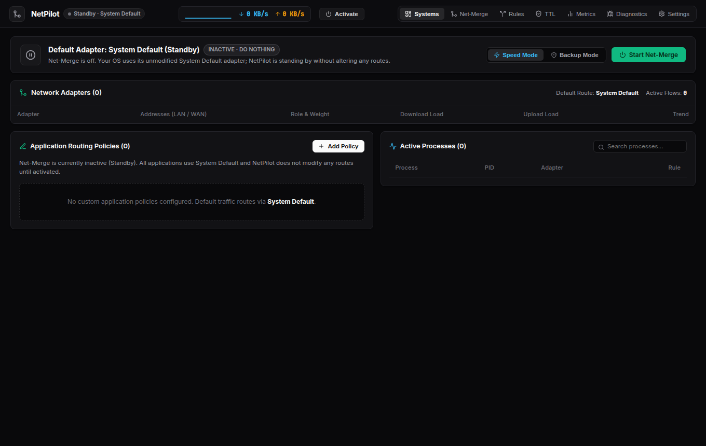
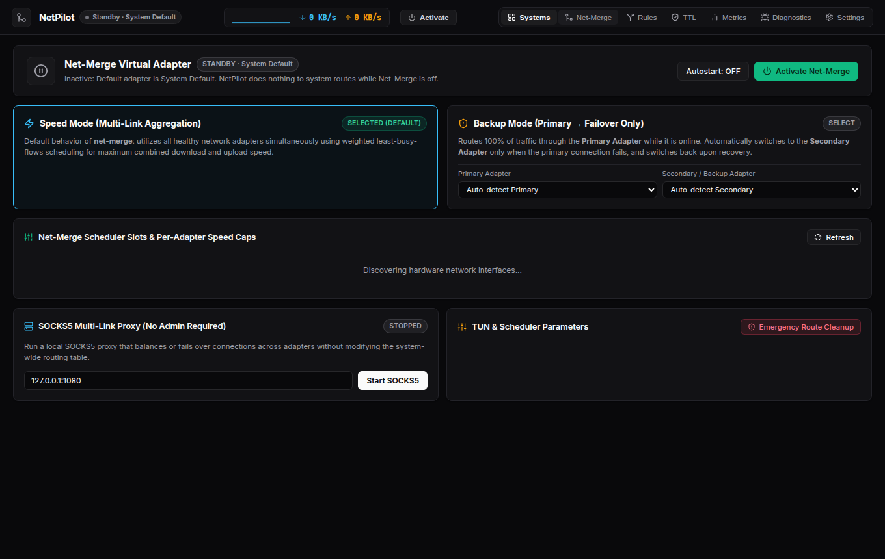
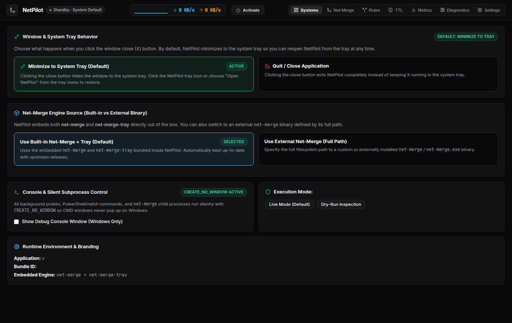

<div align="center">


# NetPilot

**The Modern Multi-Adapter Network Control Center & Bandwidth Aggregator**

Combine Wi-Fi, Ethernet, 5G Tethering, and VPNs into a single fast connection — or set up instant automatic failover when your primary link drops.

[](https://github.com/j1seki/netpilot/releases/latest)
[](#%EF%B8%8F-downloads--installation)
[](https://github.com/net-merge/net-merge)
[](LICENSE)

</div>

---

## 🖥️ Interface Overview

Redesigned with an ultra-clean, dark telemetry aesthetic inspired by **[Beszel](https://beszel.dev/)**, NetPilot gives you real-time visibility and one-click control over every network adapter on your machine.

### Systems & Adapter Telemetry
Monitor live download/upload load meters, WAN/LAN addresses, per-application routing policies, and active processes at a glance:


### Net-Merge Engine · Speed Mode vs. Backup Mode
Switch effortlessly between **Speed Mode** (simultaneous multi-link aggregation) and **Backup Mode** (active-passive failover), tune per-adapter speed caps, or run a zero-privilege SOCKS5 multi-link balancer:


### System Tray, Engine Source & Silent Execution Settings
Customize window close behavior (**Minimize to System Tray** by default vs. **Quit Application**), toggle between the **Built-in Embedded `net-merge` + `net-merge-tray`** or an **External Binary**, and run completely silently on Windows without console popups:


---

## ✨ What's New & Key Features

- 📦 **Zero Setup — `net-merge` & `net-merge-tray` Built Right In**
  Both `net-merge` and `net-merge-tray` (plus `wintun.dll` on Windows) are embedded directly inside NetPilot out of the box. You don't need to download anything extra. Want to test a custom build? Switch between **Built-in** and **External (Full Path)** anytime in **Settings**.
- ⚡ **Two Intelligent Routing Modes**
  - **Speed Mode (Default):** Combines all healthy adapters simultaneously using weighted least-busy-flows scheduling for maximum aggregate download and upload throughput.
  - **Backup Mode (Failover Only):** Routes 100% of traffic through your **Primary Adapter** (e.g., Ethernet) and switches to your **Secondary Adapter** (e.g., Wi-Fi or Phone Hotspot) *only* when the primary connection fails, automatically switching back when it recovers.
- 🛡️ **Zero-Interference Standby (`System Default`)**
  - When **Net-Merge is Active**, your default adapter is `net-merge`.
  - When **Net-Merge is Inactive**, your default adapter is `System Default` and NetPilot stands by cleanly without touching your OS routing table.
- 📥 **System Tray First (Windows, macOS & All Linux Desktop Environments)**
  - Clicking the window close (`X`) button **minimizes NetPilot to the system tray** by default (configurable in Settings to either minimize or quit).
  - Reopen NetPilot, toggle the `net-merge` adapter on/off, or switch between **Speed** and **Backup** modes directly from the tray icon.
  - Full StatusNotifierItem / AppIndicator support across **KDE Plasma, GNOME, XFCE, Cinnamon, MATE, Hyprland, Sway, and i3**.
- 🔇 **100% Silent on Windows**
  All background health probes, PowerShell/netsh queries, and `net-merge` operations run with `CREATE_NO_WINDOW` — no flashing CMD windows ever.
- 🎯 **Per-App Routing, TTL Manager & Monthly Analytics**
  Pin specific apps or games to specific adapters, customize IPv4/IPv6 Hop Limits (TTL) for hotspot carrier bypass, and track historical bandwidth usage per adapter and application.

---

## ⬇️ Downloads & Installation

Grab the latest prebuilt package for your operating system from the **[Releases Page](https://github.com/j1seki/netpilot/releases/latest)**:

| Operating System | Package | Notes |
| :--- | :--- | :--- |
| **🪟 Windows (10 / 11)** | **`netpilot-setup.exe`** / **`netpilot-windows-amd64-portable.zip`** | Single-binary NetPilot GUI + net-merge engine (auto-extracts `wintun.dll`). |
| **🍎 macOS (Universal)** | **`netpilot-macos-universal.dmg`** | Native Universal binary for Apple Silicon (`M1/M2/M3/M4`) & Intel Macs. |
| **🐧 Linux x86-64** | **`netpilot-linux-amd64.AppImage`** | Portable single-file AppImage for Ubuntu, Debian, Fedora, Arch, Mint, etc. |
| **🐧 Linux ARM64** | **`netpilot-linux-arm64.AppImage`** | Native aarch64 AppImage for ARM servers, Apple Silicon VMs (OrbStack/UTM), and Raspberry Pi-class devices. |

### Running the Linux AppImage

Make the AppImage executable and run it directly — no installation required:

```bash
# x86-64
chmod +x netpilot-linux-amd64.AppImage
./netpilot-linux-amd64.AppImage

# ARM64 (aarch64)
chmod +x netpilot-linux-arm64.AppImage
./netpilot-linux-arm64.AppImage
```

> **Linux WebKitGTK Note:** Most desktop Linux distributions include WebKit2GTK preinstalled. On minimal installations, install the WebKit2GTK 4.1 runtime if needed:
> - **Ubuntu / Debian / Mint:** `sudo apt update && sudo apt install -y libwebkit2gtk-4.1-0`
> - **Fedora / RHEL:** `sudo dnf install webkit2gtk4.1`
> - **Arch Linux:** `sudo pacman -S webkit2gtk-4.1`

---

## 🔄 Automated `net-merge` Sync & Release Pipeline

NetPilot stays automatically synchronized with upstream **[net-merge/net-merge](https://github.com/net-merge/net-merge)**:
- A scheduled GitHub Actions workflow (`.github/workflows/sync-net-merge.yml`) checks for new `net-merge` releases every 6 hours.
- Whenever a new `net-merge` version is published, GitHub Actions automatically syncs the engine, embeds both `net-merge` and `net-merge-tray`, and builds a fresh NetPilot release for Windows, macOS, and Linux.

---

## 🛠️ Building from Source

NetPilot uses **Go** for the backend/engine and **React + Vite + `typescript-go` (`tsgo`)** for the frontend.

```bash
# 1. Clone the repository
git clone https://github.com/j1seki/netpilot.git
cd netpilot

# 2. Sync the latest upstream net-merge source (optional, already synced in repo)
bash scripts/sync-net-merge.sh

# 3. Build frontend assets (typechecked with typescript-go / tsgo)
cd frontend
npm ci
npm run build
cd ..

# 4. Build and embed net-merge + net-merge-tray
mkdir -p dist internal/netmerge/embedded/bin
go build -trimpath -ldflags "-s -w" -o dist/net-merge ./cmd/net-merge
go build -trimpath -ldflags "-s -w -X main.defaultCmd=tray" -o dist/net-merge-tray ./cmd/net-merge
cp dist/net-merge internal/netmerge/embedded/bin/
cp dist/net-merge-tray internal/netmerge/embedded/bin/

# 5. Build NetPilot Desktop
go build -tags gtk3 -trimpath -ldflags "-s -w" -o dist/netpilot ./cmd/netpilot

# 6. Run the test suite
go test ./internal/... ./tests/common ./tests/scenarios
```

---

## 📄 License

Licensed under the [MIT License](LICENSE). See [THIRD-PARTY-NOTICES.md](THIRD-PARTY-NOTICES.md) for third-party attributions including [net-merge](https://github.com/net-merge/net-merge) and Wintun.
