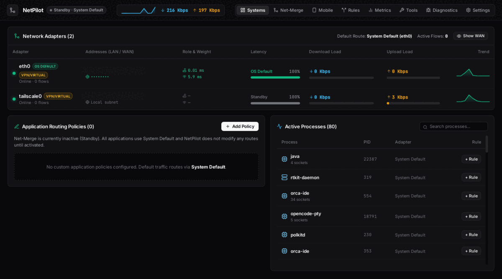

<div align="center">


# NetPilot

**Multi-adapter network control for Windows, macOS, and Linux**

Use Wi-Fi, Ethernet, and phone tethering together, or keep a backup link ready when your primary connection drops.

[](https://github.com/j1seki/netpilot/releases/latest)
[](#%EF%B8%8F-downloads--installation)
[](LICENSE)

</div>

---

## NetPilot in action



- **Systems** shows adapter traffic, active processes, and app routing rules. **Metrics** shows usage history.
- **Speed** distributes connections across healthy adapters. **Backup** switches to a secondary link when the primary fails.
- **Mobile** puts tethering profiles and link tests alongside **TTL & Hop Limit**. Preview supported desktop packet-header changes before applying them, or restore the original settings.

Download and upload speeds, idle and loaded latency, and bufferbloat measure link performance. Neither those numbers nor desktop OS read-back verify how iOS, Android, or a carrier classifies tethered traffic. See [tethering validation](docs/tethering-validation.md) for the measured baseline and test steps.

---

## ⬇️ Downloads & Installation

Grab the latest prebuilt package for your operating system from the **[Releases Page](https://github.com/j1seki/netpilot/releases/latest)**. The Latest release is always the newest stable build; prereleases are listed under **[all releases](https://github.com/j1seki/netpilot/releases)**:

| Operating System | Package | Notes |
| :--- | :--- | :--- |
| **🪟 Windows (10 / 11)** | **`netpilot-0.4.0-installer.exe`** / **`netpilot-0.4.0-windows-amd64-portable.zip`** | Single-binary NetPilot GUI + net-merge engine (auto-extracts `wintun.dll`). |
| **🍎 macOS (Universal)** | **`netpilot-0.4.0-macos-universal.dmg`** | Native Universal binary for Apple Silicon (`M1/M2/M3/M4`) & Intel Macs. |
| **🐧 Linux x86-64** | **`netpilot-0.4.0-linux-amd64.AppImage`** | Portable single-file AppImage for Ubuntu, Debian, Fedora, Arch, Mint, etc. |
| **🐧 Linux ARM64** | **`netpilot-0.4.0-linux-arm64.AppImage`** | Native aarch64 AppImage for ARM servers, Apple Silicon VMs (OrbStack/UTM), and Raspberry Pi-class devices. |

**Release:** [NetPilot v0.4.0](https://github.com/j1seki/netpilot/releases/tag/v0.4.0)

### Running the Linux AppImage

Make the AppImage executable and run it directly — no installation required:

```bash
# x86-64
chmod +x netpilot-linux-amd64.AppImage
./netpilot-linux-amd64.AppImage

# ARM64 (aarch64)
chmod +x netpilot-linux-arm64.AppImage
./netpilot-linux-arm64.AppImage
```

> **Linux WebKitGTK Note:** Most desktop Linux distributions include WebKit2GTK preinstalled. On minimal installations, install the WebKit2GTK 4.1 runtime if needed:
> - **Ubuntu / Debian / Mint:** `sudo apt update && sudo apt install -y libwebkit2gtk-4.1-0`
> - **Fedora / RHEL:** `sudo dnf install webkit2gtk4.1`
> - **Arch Linux:** `sudo pacman -S webkit2gtk-4.1`

### Choosing a net-merge engine

**Settings → Net-Merge Engine** lets you select the bundled official release, download a newer or older official version, or switch back to NetPilot's integrated engine. Stop merging and the SOCKS proxy before switching. The integrated engine supports Backup Failover and per-app routing; official downloads use Speed mode. Release builds bundle the latest stable upstream net-merge separately from the integrated engine.

On macOS, install NetPilot in Applications. If macOS blocks a copy you downloaded from the official release page, use **Privacy & Security → Open Anyway**, or the DMG's **Open NetPilot.command** helper to verify the bundle and remove quarantine from that copy after confirming.

### Automatic updates

NetPilot checks GitHub for a newer build on startup and every six hours, and can download, verify and
install it without leaving the app. Open **Settings → Automatic Updates** and pick a channel:

| Channel | Receives | GitHub meaning |
| :--- | :--- | :--- |
| **Stable** | Finished releases only (`v0.3.11`, `v0.4.0`) | Normal releases and the Latest badge |
| **Beta** | Prereleases and finished releases (`v0.4.0-beta.1`, `v0.4.0`) | GitHub prereleases plus normal releases |

Versions are compared as full semver, so `v0.4.0-beta.10` is newer than `v0.4.0-beta.9` and a stable
`v0.4.0` supersedes its own betas. New installations follow the channel of the build they came from,
and the choice is remembered in the per-user configuration directory (`%AppData%\netpilot` on
Windows, `~/Library/Application Support/netpilot` on macOS, `~/.config/netpilot` on Linux).

Every release publishes a `checksums.txt`; the updater verifies the downloaded package's SHA-256 (or
GitHub's asset digest when an older release has no checksum file) before installing. One-click
install is supported by the Windows installer and portable ZIP, the macOS `.app` bundle when it lives
in a writable location such as `/Applications`, and the Linux AppImage. Other setups get a link to the
release page instead. Beta builds are always GitHub prereleases, so the **Latest** release and the
badge on the Releases page stay on the newest stable version.

---

## 🛠️ Building from Source

NetPilot uses **Go** for the backend/engine and **React + Vite + `typescript-go` (`tsgo`)** for the frontend.

```bash
# 1. Clone the repository
git clone https://github.com/j1seki/netpilot.git
cd netpilot

# 2. Sync the latest upstream net-merge source (optional, already synced in repo)
bash scripts/sync-net-merge.sh

# 3. Build frontend assets (typechecked with typescript-go / tsgo)
cd frontend
npm ci
npm run build
cd ..

# 4. Build the single NetPilot binary (GUI + net-merge CLI + tray in one file)
go run scripts/bundle-net-merge.go
#    On Linux add -tags gtk3; on Windows add -ldflags "-H=windowsgui" to hide the console.
go build -trimpath -ldflags "-s -w" -o dist/netpilot ./cmd/netpilot

# The net-merge subcommands are built in: `dist/netpilot version`, `list`, `run`, etc.
# `internal/netmerge/VERSION` is embedded via go:embed; keep it in sync with the engine.

# 5. Run the test suite
go test ./internal/... ./tests/common ./tests/scenarios
```

---

## 📄 License

Licensed under the [MIT License](LICENSE). See [THIRD-PARTY-NOTICES.md](THIRD-PARTY-NOTICES.md) for third-party attributions including [net-merge](https://github.com/net-merge/net-merge) and Wintun.
